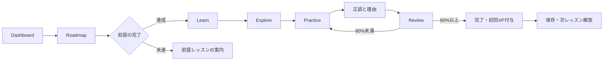

# アーキテクチャ

## 技術構成

| 領域   | 採用技術                                          | 理由                                                 |
| ------ | ------------------------------------------------- | ---------------------------------------------------- |
| アプリ | Next.js App Router / React / TypeScript           | ルーティング、型安全なUI、本番配信を一つの構成で扱う |
| UI     | Tailwind CSS / shadcn/uiの構成方式                | デザイントークンと再利用可能な小さなUI部品を管理する |
| 教材   | ローカルのTypeScript構造化データ                  | コンテンツと画面を分離し、参照と型を検査する         |
| 進捗   | `localStorage` と保存処理のインターフェース       | 外部サービスなしで動作し、将来の移行箇所を限定する   |
| テスト | Vitest / 必要なReact Testing Library / Playwright | ロジックと実際の学習フローを検証する                 |
| 配信   | Next.js対応環境、将来Vercel                       | Phase 2まで外部DB・認証・有料APIを必要としない       |

Thaiは `@fontsource-variable/noto-sans-thai-looped`（標準・ループあり）と `@fontsource-variable/noto-sans-thai`（ループなし）、日本語は `@fontsource-variable/noto-sans-jp` をnpmから導入し、アプリの静的ファイルとして自己配信する。描画時の外部フォントAPIへの依存はない。ライセンスは `public/licenses/` に同梱する。

`ThaiFontToggle` が共通ヘッダーで字体を切り替える。`html[data-thai-font]` とCSS変数 `--font-thai` を使い、明示したThai要素と日本語解説に混在するThai文字へ適用する。Thaiフォントの `@font-face` をタイ文字のUnicode範囲に限定することで、日本語・Latin・IPAの字体は既存のフォールバックで維持する。フォントファイルはCSSからnpmパッケージ内のWOFF2を参照し、ビルド時に配信用資産へ取り込む。

選択は進捗とは別の `localStorage` キー `thai-learning.thai-font.v1` に `looped` / `loopless` を保存する。初期値は標準。読み込みはhydration後に行い、無効な値は標準に戻す。保存を拒否された場合もその画面内での切替は継続でき、保存できない旨を表示する。`storage` イベントで別タブの選択変更も反映する。

書取りの薄い手本は `Noto Sans Thai Looped Variable` に固定する。全体の字体切替から独立させ、形をなぞる途中で手本が変わらないようにする。参考運筆データの軌跡もフォントから生成しない。

## 責務の分離

```text
src/app/             画面ルート、レイアウト、メタデータ
src/components/      共通UI、ナビゲーション、学習画面
src/components/ui/   Button、Card等の再利用可能なUI部品
src/data/            教材、カリキュラム、出典
src/lib/             教材型、進捗・採点などの純粋ロジック、保存アダプター
src/**/*.test.ts     教材整合性と進捗ロジックのユニットテスト
e2e/*.spec.ts        Playwrightの学習フローテスト
public/licenses/    フォントと参考運筆データのライセンス
docs/                日本語の設計・カリキュラム・開発計画
```

教材全体の参照先は `src/data/course.ts` とする。第1章の既存データは `curriculum.ts` に残し、第2・3章の追加8レッスンを `phase-two.ts`、44子音・32母音を `alphabet.ts` に分ける。`course.ts` が部・章・レッスン・出典を集約し、UIが特定の章数や第1章だけに依存しないようにする。本文や正答を画面コンポーネントへ埋め込まない。

クイズ判定・前提判定・XP計算・進捗の検証はUIから独立させる。`src/lib/content-types.ts`・`alphabet-types.ts` が教材の型、`src/lib/progress.ts` が採点・保存の境界、`src/components/learning-provider.tsx` がブラウザの状態管理を担当する。文字ノートは `alphabet-library.tsx` の `CharactersPage`、書取りは `writing-page.tsx` と `handwriting-pad.tsx` が担当する。

## 実装済みのデータモデル

| エンティティ         | 主な情報                                                                         |
| -------------------- | -------------------------------------------------------------------------------- |
| Part                 | ID、名前、説明、表示順、公開状態                                                 |
| Chapter              | ID、Part ID、名前、説明、Lessonの参照                                            |
| Lesson               | ID、Chapter ID、目標、前提Lesson ID、所要時間、XP、LearningBlock、Exercise、要点 |
| LearningBlock        | ID、見出し、解説の段落、任意の例と補足。解説の種別を分ける型はまだ持たない       |
| ExploreItem          | ID、Thai表記、IPA、日本語訳、構成・発音の注記                                    |
| Character            | 文字、名前、子音クラス、初頭音、任意の末子音、例語、出典、確認状況               |
| AlphabetCharacter    | Characterに加え、現代の使用状況、Unicode名、導入レッスン、異なる初頭音・注記     |
| VowelPattern         | 図示パターン、母音IPA、長短・特殊形、配置、対のID、用例、注記、出典・確認状況    |
| ExampleSentence      | Thai表記、日本語訳、IPA、任意の注記                                              |
| Exercise             | ID、種別、問題文、選択肢、正答、解説、学習事項、難易度                           |
| ExerciseOption       | 選択肢ID、表示内容、任意の補足                                                   |
| ContentSource        | ID、題名、発行者、URL、確認日、参照可否、確認対象                                |
| ExerciseAttempt      | Exercise ID、Lesson ID、選択した答え、正誤、回答時刻。受講回IDはまだ持たない     |
| LessonProgress       | 完了日時、最高正答率、受講回数、付与済みXP、最終学習日時                         |
| LearningProgress     | スキーマ版、Lesson別結果、回答履歴、学習したローカル日付                         |
| AudioAsset           | 素材参照先、音声種別、ライセンス、確認状況の型のみ。素材・再生機能は未実装       |
| ReferenceStrokeGuide | 対象文字ID、viewBox、記録順のSVGパス、出典・ライセンス・照合日、監修上の制約     |
| HandwritingState     | 正規化座標の線、入力中の線とポインターID。ブラウザ内の一時状態のみ               |

Phase 1は6レッスン・30問、Phase 2で8レッスン・40問を追加し、計14レッスン・70問。動作するExerciseは `multiple-choice` と `character-recognition` の判別可能な型で、ほかの採点付き演習形式は未実装。書取りはこの採点システムから分離する。追加時も未対応の形式を既存UIで誤って処理しない。

`VowelPattern` はPhase 2で独立した型と32形のデータを実装した。`Syllable`、`Vocabulary`、`GrammarPoint`、`ReviewSchedule` は将来の設計候補であり、独立した型・保存領域・画面としては未実装。現在の音節・例語の解説は `LearningBlock` と `ExploreItem` 等に保持する。SRS、語彙DB、文法リファレンスが完成済みとは扱わない。

Lesson・Character・VowelPatternは出典IDと `source-checked` / `unreviewed` を持ち、資料側に参照可否と確認対象を記録する。現教材は `unreviewed` の教材案であり、専門家の監修は未完了。運筆例の `source-checked` は記録軌跡・利用条件との限定照合で、`standardStrokeVerified: false` を必須にする。専門家による標準筆順の監修済みという意味には使わない。

## 学習フロー



回答を確定した問題は同じ受講回で書き換えない。再挑戦は新しい受講回として始める。教材の `prerequisites` が前提の唯一の定義で、URL順やXPから前提を推測しない。

## 進捗と保存

保存データのスキーマ版は `1`、保存キーは `thai-learning.progress.v1`。読み込み時にスキーマ版と各項目の型・範囲を検証する。壊れたJSON、未知の版、欠損や無効な数値はそのまま信用しない。不正な保存データは読み込み時には元のまま保持し、警告して画面内で空の進捗を使用する。その後に新しい受講結果を保存すると元の保存内容を置き換える。ブラウザの書き込み拒否等は捕捉して、保存できていない状態を伝える。

Phase 2は旧6レッスンのIDとデータを維持し、同じ保存版のLesson別レコードに新8IDを追加する。既存データの移行や初期化は不要。全レッスンの初回XPは570、第1章分240を引き継いで追加330を得られる。章数・レッスン総数の表示は `course.ts` の集約データから算出する。

Lesson別には、完了状態、最高正答率、初回完了日時、受講回数、付与済みXPを保持する。正答率80%以上で完了でき、初回完了時だけXPを付与する。再受講は以前の最高正答率を下げず、XPを重複加算しない。学習日と連続学習日数は、利用ブラウザのローカル日付を基準とする。

解説の閲覧位置や途中の回答は永続保存しない。全問を終えた受講結果の記録時に、回答履歴・受講回数・学習日を保存し、合格後の完了操作で完了状態とXPを反映する。途中で再読み込みすると、その受講回の画面内状態は失われる。

他タブの更新は `storage` イベントで同期し、保存の直前にも現在の保存内容を再読み込みする。これにより古いタブによる通常の上書きやXPの二重付与を防ぐ。localStorageにはトランザクションがないため、厳密に同時の書き込みまで保証する仕組みではない。

Progress画面は各Lessonの最高正答率・受講回数・完了状態、全受講回の初回回答の正答率、XP、学習日数を表示する。苦手概念ごとの集計、受講履歴の詳細画面、実測学習時間、SRSは未実装。

進捗アクセスは `ProgressRepository` 等の型付きインターフェースを通す。現在はブラウザの実装を利用し、将来Supabaseへ移行する際はアダプターと認証・同期の設計を追加する。Phase 2までにサーバー保存があるようには表示しない。

初期描画時は保存内容の読み込み前に「未学習」と断定しない。ブラウザAPIに依存する進捗・演習部分はClient Componentへ閉じ込め、必要以上にページ全体へ責務を広げない。

## 書取りと参考運筆例

`/writing` は44子音と32母音パターンの用例全体を選択できる。`?character=ko-kai`・`?vowel=aa-long` で文字ノートから対象を引き継ぐ。不明なIDは既定の対象へ戻し、不完全な教材を推測で作らない。

`HandwritingPad` はSVGを用紙とし、Pointer Eventsでマウス・タッチ・ペン入力を受け取る。`src/lib/handwriting.ts` が表示領域から0〜1の座標への変換、範囲の制限、描画履歴の更新、取り消し・消去を処理する。描画座標を表示のピクセル数から分離し、リサイズ時にも線と手本の位置を維持する。ポインターの捕捉・キャンセルと入力の上限を設ける。

描いた線はReactの一時状態のみ。文字の変更・画面移動で消え、localStorageや進捗の採点へ送らない。線の本数を正しい筆画数と表示せず、採点・XP・筆順評価を持たない。

`src/data/stroke-trajectories.json` は独立したMITライセンスの手録り座標4字（ก・ง・จ・ม）を保存する。`stroke-guides.ts` が元の点順を保ってSVGパスへ変換し、出典固定コミットとライセンスを付ける。`src/lib/stroke-types.ts` で不完全な参照を拒否し、`ReferenceStrokeGuide` の `standardStrokeVerified: false` と未監修の注記を保持する。再生、一筆ずつ表示、リセットを備え、動きを減らす設定では全軌跡を表示する。他の40子音と全母音には運筆アニメーションを出さない。

## 将来拡張の境界

声調判定は、将来 `Syllable` の明示的な解析結果を受け取るUI独立モジュールとする。例外の辞書補完と判定不能の結果を表現できる必要がある。Phase 3には着手せず、一般的なThai文字列から声調を推測する機能を実装しない。

正式な筆順教材は参考運筆例とは別の監修工程を必要とし、字形から手順を自動生成しない。音声は `AudioAsset` のライセンスと確認状況を満たすものだけを使用する。SRS、Supabase、AI会話、録音の実装は後続Phaseに限定する。

## 品質確認

- ユニットテスト：44字とクラス内訳・母音対、教材の参照・導入と前提関係、IPA一貫性、採点、80%境界、前提の解放、570XPと重複防止、進捗の復元・不正データ、書取りの座標と履歴。
- E2E：解説から完了まで、誤答の理由、再受講、追加章の解放、リロードによる旧進捗継続、文字検索・分類、書取り入力と操作、4字の参考運筆例の限定表示。
- 表示確認：PCとスマートフォン、横はみ出し、Thaiの上下記号、フォーカス、色に依存しない正誤表示。
- `typecheck`、`lint`、`test`、本番 `build` を実行し、実行できていない検査は理由と共に報告する。
