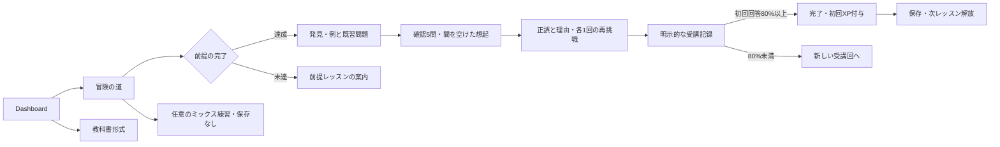

# アーキテクチャ

## 技術構成

| 領域   | 採用技術                                          | 理由                                                 |
| ------ | ------------------------------------------------- | ---------------------------------------------------- |
| アプリ | Next.js App Router / React / TypeScript           | ルーティング、型安全なUI、本番配信を一つの構成で扱う |
| UI     | Tailwind CSS / shadcn/uiの構成方式                | デザイントークンと再利用可能な小さなUI部品を管理する |
| 教材   | ローカルのTypeScript構造化データ                  | コンテンツと画面を分離し、参照と型を検査する         |
| 進捗   | `localStorage` と保存処理のインターフェース       | 外部サービスなしで動作し、将来の移行箇所を限定する   |
| テスト | Vitest / 必要なReact Testing Library / Playwright | ロジックと実際の学習フローを検証する                 |
| 配信   | Next.js対応環境、将来Vercel                       | Phase 5第1段階まで外部DB・認証・有料APIは不要        |

Thaiは `@fontsource-variable/noto-sans-thai-looped`（標準・ループあり）と `@fontsource-variable/noto-sans-thai`（ループなし）、日本語は `@fontsource-variable/noto-sans-jp` をnpmから導入し、アプリの静的ファイルとして自己配信する。描画時の外部フォントAPIへの依存はない。ライセンスは `public/licenses/` に同梱する。

`ThaiFontToggle` が共通ヘッダーで字体を切り替える。`html[data-thai-font]` とCSS変数 `--font-thai` を使い、明示したThai要素と日本語解説に混在するThai文字へ適用する。Thaiフォントの `@font-face` をタイ文字のUnicode範囲に限定することで、日本語・Latin・IPAの字体は既存のフォールバックで維持する。フォントファイルはCSSからnpmパッケージ内のWOFF2を参照し、ビルド時に配信用資産へ取り込む。

選択は進捗とは別の `localStorage` キー `thai-learning.thai-font.v1` に `looped` / `loopless` を保存する。初期値は標準。読み込みはhydration後に行い、無効な値は標準に戻す。保存を拒否された場合もその画面内での切替は継続でき、保存できない旨を表示する。`storage` イベントで別タブの選択変更も反映する。

書取りの薄い手本は `Noto Sans Thai Looped Variable` に固定する。全体の字体切替から独立させ、形をなぞる途中で手本が変わらないようにする。参考運筆データの軌跡もフォントから生成しない。

## 責務の分離

```text
src/app/             画面ルート、レイアウト、メタデータ
src/components/      共通UI、ナビゲーション、学習画面
src/components/ui/   Button、Card等の再利用可能なUI部品
src/data/            教材、カリキュラム、出典
src/lib/             教材型、進捗・採点などの純粋ロジック、保存アダプター
src/**/*.test.ts     教材整合性と進捗ロジックのユニットテスト
e2e/*.spec.ts        Playwrightの学習フローテスト
public/licenses/    フォントと参考運筆データのライセンス
docs/                日本語の設計・カリキュラム・開発計画
```

教材全体の参照先は `src/data/course.ts` とする。第1章の既存データは `curriculum.ts` に残し、第2・3章の追加8レッスンを `phase-two.ts`、第4・5章の追加8レッスンを `phase-three.ts`、第6・7章の追加8レッスンを `phase-four.ts`、44子音・32母音を `alphabet.ts` に分ける。登録語の分解・声調分析・IPA・出典は `syllables.ts`、40語の単語帳と8項目の文法ノートは `language.ts` に保持する。`course.ts` が部・章・レッスン・出典を集約し、UIが特定の章数や第1章だけに依存しないようにする。本文や正答を画面コンポーネントへ埋め込まない。

`src/data/lesson-output.ts` は全30レッスンに対応する任意の `LessonOutputTask` を1問ずつ保持する。既習語、許容する綴り、IPA・意味、問題・ヒント・理由、出典、`unreviewed` を持ち、採点用の `Lesson.exercises` とは分離する。入力・音声認識の文字列比較は `src/lib/answer-comparison.ts`、マイク録音は `microphone-recorder.ts`、ブラウザ音声認識は `speech-recognition.ts` に分ける。

クイズ判定・前提判定・XP計算・進捗の検証はUIから独立させる。`src/lib/content-types.ts`・`alphabet-types.ts`・`tone-types.ts`・`language-types.ts` が教材の型、`exercise-grading.ts` が4形式の採点、`progress.ts` が受講結果・XP・保存の境界、`learning-insights.ts` が回答履歴の集計、`src/components/learning-provider.tsx` がブラウザの進捗状態管理を担当する。文字ノートは `alphabet-library.tsx` の `CharactersPage`、書取りは `writing-page.tsx` と `handwriting-pad.tsx`、発音・声調ラボは `tone-lab.tsx` と `tone-contour.tsx` が担当する。`tone-engine.ts` はReact・ブラウザ・教材に依存しない。

語彙・文法の表示は `vocabulary-page.tsx` と `grammar-page.tsx`、復習は `review-page.tsx`、ホームと学習記録の補助表示は `review-summary.tsx` と `study-insights.tsx` に分ける。SRSの純粋な予定・検証・集計と保存アダプターは `src/lib/review.ts`、ブラウザの状態と他タブ更新の取込みは `review-provider.tsx` が担当する。受講進捗と復習予定は別々のProvider・保存キーで扱う。

## 実装済みのデータモデル

| エンティティ         | 主な情報                                                                                     |
| -------------------- | -------------------------------------------------------------------------------------------- |
| Part                 | ID、名前、説明、表示順、公開状態                                                             |
| Chapter              | ID、Part ID、名前、説明、Lessonの参照                                                        |
| Lesson               | ID、Chapter ID、目標、前提Lesson ID、所要時間、XP、LearningBlock、Exercise、要点             |
| LearningBlock        | ID、見出し、解説の段落、任意の例と補足。解説の種別を分ける型はまだ持たない                   |
| ExploreItem          | ID、Thai表記、IPA、日本語訳、構成・発音の注記                                                |
| Character            | 文字、名前、子音クラス、初頭音、任意の末子音、例語、出典、確認状況                           |
| AlphabetCharacter    | Characterに加え、現代の使用状況、Unicode名、導入レッスン、異なる初頭音・注記                 |
| VowelPattern         | 図示パターン、母音IPA、長短・特殊形、配置、対のID、用例、注記、出典・確認状況                |
| SyllableEntry        | 1音節のThai表記・IPA・訳、初頭・母音・末尾、分析、登録声調、出典・確認状況、任意の辞書補完   |
| SyllableAnalysis     | 子音クラス、母音長、末音種別、声調記号、単子音／真正子音連続／先行子音の区別                 |
| ToneResult           | 判定済みの声調・生死・有効クラス・説明手順・適用方法、または判定不能の理由                   |
| ExampleSentence      | Thai表記、日本語訳、IPA、任意の注記                                                          |
| Exercise             | ID、種別、問題文、選択肢・許容綴り・語句、正答ID・語順、解説、学習事項、難易度               |
| ExerciseOption       | 選択肢ID、表示内容、任意の補足                                                               |
| ContentSource        | ID、題名、発行者、URL、確認日、参照可否、確認対象                                            |
| ExerciseAttempt      | Exercise ID、Lesson ID、選択した答え、正誤、回答時刻。受講回IDはまだ持たない                 |
| LessonProgress       | 完了日時、最高正答率、受講回数、付与済みXP、最終学習日時                                     |
| LearningProgress     | スキーマ版、Lesson別結果、回答履歴、学習したローカル日付                                     |
| AudioAsset           | 録音素材用の参照先・種別・ライセンス型。録音素材は未収録、端末合成は別モジュール             |
| ReferenceStrokeGuide | 対象文字ID、viewBox、記録順のSVGパス、出典・ライセンス・照合日、監修上の制約                 |
| HandwritingState     | 正規化座標の線、入力中の線とポインターID。ブラウザ内の一時状態のみ                           |
| LessonOutputTask     | 既習語の任意課題。Lesson ID、問題、見本・IPA・意味、許容綴り、ヒント・理由、出典、未検証状態 |
| VocabularyEntry      | Thai、訳、IPA、カテゴリー、導入レベル、音節区切り、例文、関連Lesson、出典、確認状況          |
| GrammarPoint         | 題名、要点、日本語の説明、構文の型、語句の役割付き例文、関連語彙・Lesson、出典、確認状況     |
| ReviewCard           | 語彙ID、期限、間隔日数、段階、前回日時、やり直し回数、累積復習回数                           |
| ReviewAttempt        | 回答ID、語彙ID、日時、自己評価、次の間隔日数                                                 |
| ReviewState          | 保存版 `1`、語彙ID別カード、直近1000回の自己評価履歴                                         |
| CourseMission        | 対象Lessonまたは任意復習、開始時に固定したカード列、成績対象のExercise ID。画面内のみ         |
| MissionCard          | 元の解説・確認項目・問題と、必須／既習復習／想起／再挑戦の用途。画面内のみ                    |

Phase 1は6レッスン・30問、Phase 2・3・4で各8レッスン・40問を追加し、計30レッスン・150問。Exerciseは `multiple-choice`・`character-recognition`・`fill-in-the-blank`・`word-ordering` の判別可能な型とする。`exercise-input.tsx` で形式に応じた入力を表示し、`gradeExercise` で未回答・不正な構成を除外して正誤と保存用IDを返す。空欄は許容綴りと前後空白以外を変えずに比較する。語順は語句IDの順序と重複・欠落・未知IDを検査する。

選択式の `selectedOptionId` は従来通りの選択肢ID、入力形式の正答は教材の正答ID、誤答は固定の `__incorrect__` とする。生の入力・語句列は履歴へ保存せず、既存の `ExerciseAttempt` と進捗版 `1` を維持する。回答の確定後はその受講回の状態を固定し、答えを選び直して正答率を上げない。書取り、ラボの条件変更、30個の任意入力・録音課題、SRSの自己評価はこの採点システムから分離する。

`VowelPattern` は32形、`SyllableEntry` は32語の独立したデータを持つ。音節カタログは声調規則の教材用であり、一般語彙辞書ではない。Phase 4の `VocabularyEntry` は40語、`GrammarPoint` は8項目を持つ。語彙の音節区切りは教材側で指定し、任意文字列の自動分割に流用しない。SRSは `ReviewCard` の期限と段階を独立した保存領域へ保持する。外部DB・サーバーAPIは不要で、一般語彙辞書や文法の網羅は対象外。

Lesson・Character・VowelPattern・SyllableEntry・VocabularyEntry・GrammarPointは出典IDと `source-checked` / `unreviewed` を持ち、資料側に参照可否と確認対象を記録する。現教材は `unreviewed` の教材案であり、専門家の監修は未完了。基本声調表、40語の単語IPA、一部の文法機能の限定照合は、個々の訳・例文の自然さ・説明全体の監修と分けて記録する。既存本編の例文IPAは採用した単語IPAを組み合わせた学習用表記で、連続発話を照合した転記ではない。Phase 5の会話では文全体のIPAを生成せず、単語の読み方だけを参照する。Phase 4の確認範囲とIPAの帰属・継承条件は [PHASE4_SOURCES.md](PHASE4_SOURCES.md) を参照する。運筆例の `source-checked` は記録軌跡・利用条件との限定照合で、`standardStrokeVerified: false` を必須にする。専門家による標準筆順の監修済みという意味には使わない。

## 会話ミッション（Phase 5第1段階）

`src/lib/conversation-types.ts` が `ConversationWord`・`ConversationPhrase`・`ConversationChoice`・`ConversationStep`・`ConversationScenario` を定義し、`src/data/conversations.ts` が4シーン各3ステップ、語のIPA、出典・確認状況を持つ。文全体のIPAは持たず、語の参照IDを教材側で明示する。語のIPAの照合を台本・訳・自然さの監修へ広げない。

`src/lib/conversation.ts` は目的に対する返答の判定、全ステップの終了検証、独立した保存値の検証・重複防止・原文保護を担当する。`use-conversations.ts` がhydration後の復元と明示的な記録・保存通知、`conversation-practice.tsx` が一覧・やりとり・理由・再試行・振り返りを扱う。録音・ASRや外部APIは追加せず、TTSは既存の明示再生と音声優先を使う。

保存キーは `thai-learning.conversation.v1`、版は `1`。`ConversationProgress` はシーンID別の終了回数・最終終了日時と直近100件のセッションIDだけを持つ。回答・会話履歴・音声は保存せず、旧進捗・SRS・XP・前提・クエストへ書き込まない。保存前には全ステップが元の順序でそろい、各選択が受け付ける返答かを検証する。不正・未知の原文は明示的な置換まで保護し、保存不可でもタブ内で続けられる。詳細は [PHASE5_SPEC.md](PHASE5_SPEC.md) を参照する。

## 学習フロー



回答を確定した問題の成績は同じ受講回で書き換えない。ミッション内の再挑戦は成績に含めず、成績を更新する場合は新しい受講回として始める。教材の `prerequisites` が前提の唯一の定義で、URL順やXPから前提を推測しない。

`src/lib/course-mission.ts` は既存教材と進捗からカード列を作る純粋なモジュール。`buildLessonMission` は現在の全ブロック・確認項目を保持し、完了済みの既知レッスンから最大2問を挟み、全ての新しい説明を提示してから現在の課の確認5問（`core`）を出す。画面では「チェックポイント」と示す。現在の問題の想起を2問含め、`appendMissionRetry` は同じ問題の再挑戦を1回まで追加する。解説と問題の未定義な対応を推測しない。`getMissionExercise` は既存の文字列・正答・入力仕様を保って選択肢の順序だけを変える。

`buildMixedReviewMission` は前提を満たして完了した既知レッスンから、最新の誤答・範囲の広がり・古さを基に最大6問を選ぶ。seedは再現可能な選択と画面内の組み合わせ変更に使い、保存しない。どちらの生成処理もReact・音声・時計・保存APIへ依存しない。

`/play` の道は次に可能な課と完了状態を既存の進捗から導出する。`/play/[lessonId]` は開始時の出題列、カード位置、練習の回答と現在の課の確認5問それぞれの初回回答を分けて保持する。先に既習問題が出るため、画面に最初に出る5問ではなく `purpose: core` の5問を成績対象とする。明示的な受講終了時にその初回回答だけを `LearningProvider.finishLesson` へ渡し、二重操作を防ぐ。結果は「確認5問の初回正解」、条件は「確認5問の初回回答で4問以上正解」と示す。`/play/mix` はProviderの記録処理を呼ばない。新しい保存キー・版、XP、SRS予定は設けない。詳しくは [MISSIONS.md](MISSIONS.md) を参照する。

教科書形式の `/lessons/[lessonId]` は既存の `LessonPlayer` と4段階を維持する。Learnの `LessonDiscovery` は `Lesson.blocks` を1枚ずつ表示し、番号選択・前後移動・画面内だけのチェックと全カードの表示切替を担当する。Exploreの `LessonRecallGame` は既存の `Lesson.explore` を使う任意のめくり練習で、元の比較カードと入力・録音練習を置き換えない。`src/lib/lesson-recall.ts` は対象ID、初回・読み返し・終了の段階、位置、答えの表示、初めてめくったID、読み返し対象を扱う純粋な状態遷移。答えを開いてから進み、選んだ対象だけ1回読み返す。進行やチェックを保存・採点・XPへ送らず、音声・SE・時計へ依存しない。詳細は [LESSON_GAMES.md](LESSON_GAMES.md) を参照する。

## 進捗と保存

保存データのスキーマ版は `1`、保存キーは `thai-learning.progress.v1`。読み込み時にスキーマ版と各項目の型・範囲を検証する。壊れたJSON、未知の版、欠損や無効な数値はそのまま信用しない。不正な保存データは読み込み時には元のまま保持し、警告して画面内で空の進捗を使用する。その後に新しい受講結果を保存すると元の保存内容を置き換える。ブラウザの書き込み拒否等は捕捉して、保存できていない状態を伝える。

Phase 4は旧22レッスンのID・110問・890XP・前提を維持し、同じ保存版のLesson別レコードに新8IDを追加する。既存データの移行や初期化は不要。全レッスンの初回XPは1210、第1〜5章分890を引き継いで追加320を得られる。第6章の入口は `tone-reading-review` の完了を前提とする。章数・レッスン総数の表示は `course.ts` の集約データから算出する。ラボの検索・条件変更・図の比較は進捗データへ保存しない。

任意の文字入力、音声認識の結果、録音は `LearningProgress` に入れず、localStorage・DB・サーバーへ保存しない。30課題へ拡張しても、任意練習の一致・相違で完了や前提を解放しない。必須クイズの入力形式だけは上記の固定IDで正誤を記録する。

Lesson別には、完了状態、最高正答率、初回完了日時、受講回数、付与済みXPを保持する。正答率80%以上で完了でき、初回完了時だけXPを付与する。再受講は以前の最高正答率を下げず、XPを重複加算しない。学習日と連続学習日数は、利用ブラウザのローカル日付を基準とする。

解説の閲覧位置や途中の回答は永続保存しない。全問を終えた受講結果の記録時に、回答履歴・受講回数・学習日を保存し、合格後の完了操作で完了状態とXPを反映する。途中で再読み込みすると、その受講回の画面内状態は失われる。

他タブの更新は `storage` イベントで同期し、保存の直前にも現在の保存内容を再読み込みする。これにより古いタブによる通常の上書きやXPの二重付与を防ぐ。localStorageにはトランザクションがないため、厳密に同時の書き込みまで保証する仕組みではない。

Progress画面は各Lessonの最高正答率・受講回数・完了状態、全受講回の初回回答の正答率、XP、学習日数を表示する。Phase 4では、各問題の最新の確定回答から求める苦手概念、関連レッスン、直近8件の解答、ローカル日付による直近7日の活動を追加する。過去の誤答だけを永久に苦手扱いせず、同じ問題への新しい回答を優先する。SRSの登録数・期限到来数・累積復習回数・間隔が7日以上の語数は、クイズ正答率と別に表示する。実測学習時間、未回答問題の理解度や語彙習熟度の推定は行わない。

進捗アクセスは `ProgressRepository` 等の型付きインターフェースを通す。現在はブラウザの実装を利用し、将来Supabaseへ移行する際はアダプターと認証・同期の設計を追加する。Phase 4までにサーバー保存があるようには表示しない。

初期描画時は保存内容の読み込み前に「未学習」と断定しない。ブラウザAPIに依存する進捗・演習部分はClient Componentへ閉じ込め、必要以上にページ全体へ責務を広げない。

## SRSの予定と保存

単語帳で利用者が登録した語だけに `ReviewCard` を作り、初回はすぐ復習できる期限にする。登録済みの再登録で段階を戻さない。復習画面は開始時点で期限が来た最大20語のIDを固定し、Thaiから意味を思い出して答えを表示した後に自己評価する。同じ語をその回で繰り返さず、回答IDによって二重操作の重複記録を防ぐ。画面の時計を定期更新し、開いたままでも期限の表示を更新する。

`reviewCard` は自己評価から次の予定を計算する。「もう一度」は10分後・段階0、「迷った」は1日後・段階を維持、「思い出せた」は1・3・7・14・30・60日へ段階を進め、60日を上限にする。記憶確率を推定する学習モデルではなく、習熟度やXP、レッスン解放に変換しない。日時はISO形式で保存し、画面では端末の日時を使う。

保存キーは独立した `thai-learning.review.v1`。`LocalStorageReviewRepository` が保存版、既知の語彙ID、日時・間隔・段階・回数の整合性、履歴の順序・重複を検査する。履歴は直近1000回に制限し、各カードの復習回数は累積で保持する。不正JSON・未知版・未知語IDの元データは自動で上書きせず、通知して画面内のメモリで続ける。ブラウザの保存拒否も捕捉し、永続保存できていないことを表示する。受講進捗の保存処理とは壊れたデータの扱いが異なるため、同一の動作として説明しない。

Providerは保存直前の再読込と `storage` イベントで通常の別タブ更新を取り込む。保存できなかった画面内の変更は有効な保存内容へマージする。localStorageにはトランザクションがなく、厳密に同時の書き込みまで原子的に保証しない。別端末との同期・クラウド保存・バックアップは未実装。

## 独立した文字トレーニング

`src/app/character-practice/page.tsx` は `focus` を既知の文字IDに限定して `CharacterTraining` へ渡す。教材は `src/data/alphabet.ts` を再利用し、練習セット、読み方の表示、確認用の日本語補足を `src/data/character-training.ts`、出題と採点を `src/lib/character-trainer.ts`、保存検証を `src/lib/character-training-progress.ts` に分離する。ブラウザ側の状態と保存通知は `use-character-training.ts`、画面は `character-training.tsx`、表示は `character-training.css` が扱う。`character-audio-prompt.tsx` は共有の `useThaiSpeech` と音声優先の境界を使って完全な字母名を再生する。

`src/lib/character-selection.ts` は19固定セットとは独立して、現用42字から4字・8字を提案する純粋な処理。未練習・直近誤答を優先し、足りない候補を補い、前回と同じ集合なら1字を交換する。seed・記録・前回選択だけを受け取り、保存・時計・音声を呼ばない。提案の生成は下書きで、通常の確認学習・8問の開始まで保存しない。

`TrainerSession` はセッションID・2〜8字の選択・モード・8問を持ち、指定seedから再現できる順序で選択文字を偏りすぎず出題する。画面で選べるのは音声→文字（`audio-to-letter`）と読み方→文字（既存の `name-to-letter`）だけ。音声形式は `name` の完全な字母名を読み上げ、正解を示す字形・字母名を問題文や再生ボタンのラベルへ先に出さず、字形の選択肢を示す。読み方形式は既存 `ipa` の最初の音節と、`unicodeName` の `THAI CHARACTER ` を除いて小文字にした字母名全体の英字表記を示す。ラベルで両者の範囲を区別し、Unicode名を音声転写や字母名全体のIPAと見せない。日本語の名詞の手がかりは確認・解答後の情報だけに使い、問題文には含めない。Unicode文字列・IPAを正規化したり、未知の読み・完全な字母名IPA・カタカナを生成したりしない。

`src/lib/character-pairs.ts` は選択した2〜8字のペア盤面と組合せ判定を扱う純粋なロジック。1周で選択全字を1回ずつ使い、2周目はカードと文字を独立に並べ替える。ペアさがしの画面コンポーネントは選択中の手がかり、正解で固定したペア、誤答の理由、2周の進行、その回の文字コレクションをReactの一時状態だけで保持する。保存モジュールを呼ばず、設定・文字別記録・XP・SRS・クエスト・バッジへ書き込まない。N文字の2周は2Nペアであり、8問分の記録へ変換しない。

音声ペアは選んだ手がかりごとに再生対象を固定し、明示再生の正常終了後かつ再生中でない場合に対応する字形を選べる。新しい手がかり、周の変更、戻る・アンマウントでは古い再生と遅延完了を無効にする。音声カードの押下を再生の明示操作として扱い、選択と再生要求を同じイベント内で行う。同じカードの押下も聞き直しとして回答解放を取り消す。ページ・周の表示や音声準備の完了だけでは再生しない。読み方形式は既存の最初の音節IPAとUnicode名の英字表記を一緒に表示する。音声非対応・失敗からの明示的な読み方への切替は、同じ対象で1周目を新しく始める。2周後の任意の8問開始には実際の形式を渡し、通常のクイズを終えた結果だけを既存保存処理へ送る。

内部の `mixed` / `letter-to-sound` は互換性のため残し、旧形式の初頭音重複・有効な別音の除外を維持する。ただし画面では選べず、旧形式を読み込んだ場合は `name-to-letter` へ表示上読み替える。

音声の回答解放は問題ごとに管理し、正常な再生終了後かつ再生中でない場合だけ採点・スキップを許可する。取消し・失敗を再生完了にせず、再再生の開始と問題変更で解放状態を取り消す。非対応時の読み方形式への明示切替では未終了の音声セッションを破棄する。読み方形式は表示だけで答えられるため、任意の字母名再生を採点条件にしない。TTSを音声の自然さ・発音や声調の採点として使わず、操作のない再生もしない。読み方形式の任意の再生ボタンは折りたたまずに表示する。

保存キーは `thai-learning.character-training.v1`。保存版 `1` と既存の形式IDを維持し、空データの既定だけを音声形式にする。旧形式の設定は検証時に引き続き認め、画面内の読み替えだけでは保存し直さない。従来の確認学習・8問の開始操作で現在の形式を保存し、旧記録は保持する。ペアさがしの開始・試行・終了では設定も保存しない。`CharacterTrainingState` は版 `1`、選択設定、文字ID別の正解・誤答回数・直近日時・直近の正誤、終了回数、直近100件のセッションIDを持つ。未終了の問題と回答は画面内のみ。完了した8問を一度だけ反映し、同じセッションIDの再保存では回数を増やさない。既知の44字・2〜8字・列挙値・有限な整数・日時・記録の整合性を検証する。不正・未知版は原文を保持し、利用者の明示的な保存やり直し操作まで上書きしない。保存できない場合もこのタブ内の記録で続けられる。

通常の別タブ更新は読込み直しと変更通知で取り込み、厳密に同時の書込みは保証しない。受講進捗・SRS・クエストから独立させ、XP、前提の解放、学習日・バッジ・日次クエスト、単語復習予定を変更しない。直近の誤答は再練習候補であり、文字の習熟度を測定した値ではない。既存のTTS・字体・音声優先とSE設定を利用する。詳細は [CHARACTER_TRAINING.md](CHARACTER_TRAINING.md) を参照する。

## 書取りと参考運筆例

`/writing` は44子音と32母音パターンの用例全体を選択できる。`?character=ko-kai`・`?vowel=aa-long` で文字ノートから対象を引き継ぐ。不明なIDは既定の対象へ戻し、不完全な教材を推測で作らない。

`HandwritingPad` はSVGを用紙とし、Pointer Eventsでマウス・タッチ・ペン入力を受け取る。`src/lib/handwriting.ts` が表示領域から0〜1の座標への変換、範囲の制限、描画履歴の更新、取り消し・消去を処理する。描画座標を表示のピクセル数から分離し、リサイズ時にも線と手本の位置を維持する。ポインターの捕捉・キャンセルと入力の上限を設ける。

描いた線はReactの一時状態のみ。文字の変更・画面移動で消え、localStorageや進捗の採点へ送らない。線の本数を正しい筆画数と表示せず、採点・XP・筆順評価を持たない。

`src/data/stroke-trajectories.json` は独立したMITライセンスの手録り座標4字（ก・ง・จ・ม）を保存する。`stroke-guides.ts` が元の点順を保ってSVGパスへ変換し、出典固定コミットとライセンスを付ける。`src/lib/stroke-types.ts` で不完全な参照を拒否し、`ReferenceStrokeGuide` の `standardStrokeVerified: false` と未監修の注記を保持する。再生、一筆ずつ表示、リセットを備え、動きを減らす設定では全軌跡を表示する。他の40子音と全母音には運筆アニメーションを出さない。

## 音節分析と声調判定

`src/lib/tone-types.ts` は `SyllableAnalysis` と、`determined` / `unknown` で分岐する `ToneResult` を定義する。`determineTone(unknown)` は入力オブジェクトのキー・値を実行時にも検証し、子音クラス、母音長、末音、生死、声調記号、初頭構造の基本規則を適用する。結果には有効クラス・生死・説明手順を含める。未対応の記号・クラスの組み合わせや不正入力は、推測せず理由付きの `unknown` にする。

`src/data/syllables.ts` は32個の登録語のThai・IPA・訳、文字上の初頭・母音・末尾、発音上の条件を保持する。`lookupSyllable` は前後の空白を除いた完全一致のみで検索し、Unicode結合文字を分割・並べ替えない。文字の並びから音節を生成する処理は持たない。`analyzeEntry` は登録声調と規則結果の不一致を拒否し、確認が終わるまで判定を表示しない。

真正子音連続は先頭クラスを使用し、ห นำ・อ นำはカタログで確認した適用対象の条件として渡す。エンジンは、任意の文字列にその規則が適用できるかを解析しない。辞書補完を使う場合は `dictionaryOverride` の理由と出典ID、`source-checked`、登録声調との一致を要求し、結果の `method` を `dictionary` にする。現在の32語に例外指定はなく、補完機構はテスト用の分析データで検証する。

`/pronunciation` の `ToneLab` は、登録語の分解と判定手順、未知語の説明、手動条件指定を表示する。`ToneContour` はChao表記に合わせた静止SVGの模式図を描く。録音の実測ピッチではなく、図から合成音声を生成しない。ラボは採点・XP・進捗保存から独立する。配布する実録音教材は未収録。端末合成音声は下記の独立した境界で扱う。

## 将来拡張の境界

任意のタイ語の形態素解析、一般的な音節分割、網羅的な例外辞書は未実装。現在の明示的な分析条件を受け取る境界を保ち、後で辞書や解析器を追加する場合も、確認状況と判定不能の扱いを省略しない。

正式な筆順教材は参考運筆例とは別の監修工程を必要とし、字形から手順を自動生成しない。配布する録音教材は `AudioAsset` のライセンスと確認状況を満たす必要がある。利用者の短時間録音は任意練習で扱い、SRSはPhase 4の独立した予定管理として実装する。発音・声調の自動評価、Supabase、認証、AI会話、PWA・オフライン対応、公開デプロイは未実装。

## 品質確認

- ユニットテスト：44字とクラス内訳・母音対、教材の参照・導入と前提関係、IPA一貫性、150問と4形式の採点、80%境界、前提の解放、1210XPと重複防止、進捗の復元・不正データ、書取りの座標と履歴、声調規則の主要分岐・判定不能・辞書補完。
- Phase 5第1段階：シーン・語・出典・関連レッスン、受け付ける返答の参照、全ステップの終了検証、完了メタデータの保存・原文保護・重複防止、旧XP・SRSへの非干渉、明示TTSと非対応、狭い画面・文字拡大・キーボード。
- Phase 4のロジック：40語・8文法項目の参照、入力のUnicode保持、語句IDの重複・欠落、SRSの期限と段階、履歴上限と累積回数、保存の検証と元データ保護、マージ、最新回答による苦手概念とローカル日付の活動集計。
- E2E：解説から完了まで、誤答の理由、初回回答の固定、再受講、追加章の解放、リロードによる旧進捗継続、単語・文法の検索と関連先、SRSの登録・自己評価・復元・保存失敗・複数タブ、文字検索・分類、書取り入力と操作、4字の参考運筆例の限定表示、発音ラボの登録語・未知語・手動条件。
- 任意入力・音声：30課題の参照・既習範囲、Unicodeを保持する完全一致、空・不正入力、TTSの対象判定、録音上限・機器終了・URL解放、ASRの非対応・拒否・時間切れ・遅延イベント、相互排他と既存進捗への非干渉。模擬APIによる検証と実端末の音声品質の確認は検証記録で区別する。
- 表示確認：PCとスマートフォン、横はみ出し、Thaiの上下記号、フォーカス、色に依存しない正誤表示。
- `typecheck`、`lint`、`test`、本番 `build` を実行し、実行できていない検査は理由と共に報告する。

実行結果・件数と実ブラウザの確認範囲は [VALIDATION.md](VALIDATION.md) に記録する。

## 端末の合成音声

`device-speech.ts` は端末の能力と再生を管理する。実際の音声一覧からタイ語のみ選び、端末内の候補を優先する。声の非同期取得と変更、開始・完了・エラー、イベントが返らない場合のタイムアウトを扱う。所有者ごとにセッションを持ち、音声の切替時は前の再生を止め、古いイベントで新しい再生を完了扱いしない。画面移動はその所有者の音声だけを停止する。

`SpeakButtonHandle.play(text?)` と `CharacterAudioPromptHandle.play(questionId, text)` は、音を聞くことを示した選択操作から同期的に再生を要求するための境界。文字タブ・比較カード・登録語の選択と、再生ボタンの両方から既存のプレイヤーを使う。選択操作から呼び出すプレイヤーは対象ごとに再マウントせず、すでに要求した新しい文面を、props更新時に古い音声と誤認して取り消さない。対象が変わっただけで新しい再生を開始するeffectは持たない。

`useThaiSpeech.play` は操作時にも利用可能なThai音声を確認し、再生要求を出せたかを真偽値で返す。この返り値を聞き終えた判定には使わず、音声問題・ペアの回答解放は現在の対象の正常終了通知だけに基づく。音声が未準備の場合は後から再生する要求を予約しない。ページ表示、次問、周の開始、答えの表示、音声一覧の更新だけでは音を出さない。

本編の比較カードは実語だけを対象にし、録音・音声認識中の選択は表示変更だけにする。声調ラボも登録済みかつ判定可能な語の選択・検索に限り、未知語・声調曲線・手動条件から読みを生成しない。SRSの再生ボタンは意味の表示前から使え、再生による予定・自己評価の変更はない。

`SpeakButton` は全30レッスンのLearnの例語・Explore、ラボの登録語、単語帳、文法ノート、復習に付く。`isThaiSpeechText` でThai文字と空白の語を選び、子音位置のハイフン、分解の記号、IPA、Latinを含む図式は読み上げない。`SpeechPractice` は独立した任意の3問で、文字・IPA・解説は `speech-practice.ts` に分離する。音声の完了後だけ答えを確認でき、回答確定後は選び直せない。XP・受講結果・進級には使わない。声がなければ問題を有効にせず理由を示す。

音声ファイルを配信・保存する機能ではない。ブラウザとOSの音声サービスをユーザー操作で呼び出し、端末の合成音声・未監修と明示する。提供元への通信があり得る声も表示する。再配布できる録音素材と、そのライセンス情報を持つ `AudioAsset` は未収録である。

## 任意の文字入力・録音・音声認識

`LessonPlayer` のExploreに `LessonOutputPractice` を置き、文字モードと声モードを切り替える。文字モードは `compareThaiAnswer` で前後の `trim()` のみ行い、許容綴りと完全一致比較する。Unicode正規化、結合文字の並べ替え、句読点の除去、語中の空白の結合はしない。判定後に見本・IPA・理由を表示し、成績には加算しない。

`LessonRecorder` は `microphone-recorder.ts` のアダプターを通して、利用者操作後に `getUserMedia` と `MediaRecorder` を呼ぶ。最大20秒で停止し、5MBを超えた録音は破棄する。BlobとObject URLを画面内のメモリだけに保持する。再生・削除、入力対象の変更、画面破棄・離脱時に再生を止め、マイクのトラックとObject URLを解放する。遅れて許可されたマイクも、失効した録音セッションへ保持しない。アプリからの録音アップロードや永続保存は行わない。

`speech-recognition.ts` は `SpeechRecognition` / `webkitSpeechRecognition` がある場合だけ利用し、`th-TH`、非連続、最終結果1候補、約9秒の上限で呼ぶ。認識の開始前にブラウザ提供元へ音声が送信され得ることを表示し、利用者操作で開始する。受け取るイベントを検証して、最終文字列を同じ完全一致関数で比較する。信頼度、録音ピッチ、発音・声調の点数は計算しない。停止・破棄後の古い認識イベントは結果に反映しない。

録音と音声認識は同時に開始せず、開始時にTTS・録音の再生を停止する。マイク使用中は見本のTTS再生を無効にする。非対応・権限拒否・マイク不在・機器使用中・認識エラーでは理由を示し、文字入力・録音の聞き直し・通常の教材へ戻れる。配布音声と利用者の録音、音声認識の通信は異なる機能として表示する。詳細は [LESSON_OUTPUT_SPEC.md](LESSON_OUTPUT_SPEC.md) を参照する。

## 効果音と教材音声の優先

`sound-effects.ts` は `correct`・`incorrect`・`lesson-complete`・`review-complete` の短い独自音列を定義し、Web Audio APIの正弦波とゲイン包絡で再生する。外部ファイル・API・依存パッケージは追加しない。ブラウザのアダプターを狭く分け、再生の開始待ち・重複・停止・破棄後の遅延結果を独立して検証する。音声教材や発音採点へ流用しない。

`sound-preferences.ts` が `thai-learning.sound.v1` の `{ version: 1, enabled: boolean, volume: number }` を検証する。初期値はオフ・0.35で、音量は0〜1の有限数。不正・未知版は無音へフォールバックし、マウント時に元の保存値を修復・上書きしない。明示的な設定変更時だけ保存する。`SoundEffectsProvider` は設定とタブ内状態を管理し、保存不可なら通知してこのタブの選択を維持する。進捗・SRS・字体とは保存先と状態を分ける。

`SoundSettings` は共通ヘッダーに入口を置き、ネイティブの `dialog`、スイッチ、音量のrange、試聴ボタンを提供する。設定変更・保存の復元・他タブの変更で自動再生せず、ユーザーの回答確定・完了・試聴操作からだけ再生を要求する。文字トレーニングの最初の確定回答とペアさがしの各試行に `correct` / `incorrect`、8問終了とペア2周後の明示的な完了・クイズへの移動操作に `review-complete` を要求する。問題表示、記録復元、自動的なペア完了表示では終了音を鳴らさない。SRSは少なくとも1語を自己評価してその回を終えたときだけ終了音を要求する。再受講の合格完了はXP付与の有無と独立し、任意入力や認識文字列の一致は音を要求しない。

`audio-focus.ts` が教材音声・マイクを使う所有者を管理する。TTS、マイク許可待ちから録音終了まで、音声認識、録音の再生が音声の使用を取得し、終了・エラー・破棄で解放する。使用中は効果音を抑止し、使用開始の通知で開始待ち・再生中の効果音を停止する。抑止した効果音をキューに残さない。Providerはルート変更、タブ非表示、`pagehide` と破棄でも音を止める。詳細は [SOUND_EFFECTS.md](SOUND_EFFECTS.md) を参照する。

## 表示密度と図のコンポーネント

`layout.tsx` は `globals.css` の後に `visual-refresh.css` を読み込む。共通の文字サイズを `--text-body`（1rem）、`--text-learning`（1.125rem）、`--text-small`（0.875rem）、`--text-caption`（0.75rem）で管理する。既存画面の小さい固定文字もこの変数を参照し、本文や操作を狭い画面だけ極端に縮めない。ホーム・レッスン・参照・記録の構造は `visual-home.css`・`visual-lesson.css`・`visual-reference.css`・`visual-progress.css` に分ける。CSSの最終的な順序と折返しは本番ビルドでも確認する。

`lesson-visuals.tsx` の `LearningBlockCard` は第一段落、例、注意、calloutを常設し、補足段落を標準の `details` / `summary` へ移す。`ExampleVisual` は既存の登録語とThai・IPAが一致するときだけ音節分析と明示声調を図示し、既存文法例の完全一致時だけ `segments` の役割を表示する。新しい声調判定・音節分割・文法解析は追加しない。原文・IPA・Unicodeの保持、TTSの対象判定、採点・保存の境界は従来どおり。

単語カテゴリー、文法の型、章の完了ステップ、学習記録をアイコン・チップ・バーで表す。7日の棒グラフは既存 `getLearningInsights` の実解答数だけを使い、学習時間や習熟度を推定しない。読み込み中はグラフを表示せず、0件と区別する。詳しい表示方針は [VISUAL_DESIGN.md](VISUAL_DESIGN.md) を参照する。

## 既存記録から導出するクエストとバッジ

`src/lib/gamification.ts` の `getGameProgress` は、検証済みの受講・復習記録、現在の教材参照、明示的な現在日時を入力として、日次クエスト・経験レベル・8バッジの表示モデルを返す純粋関数とする。保存、XP付与、採点、前提の解放を行わない。新しいlocalStorageキーや保存版は設けず、進捗版 `1` と独立したSRSを引き続き使う。

日次集計はローカル日付を使い、未来の日時・未知の課や設問・完全に重複した回答を数えない。終了受講の `lastStudiedAt`、確定回答の `attemptedAt`、SRSの `reviewedAt` を参照する。累計学習日は有効な `studyDays` の重複を除き、復習バッジはカードの累計 `reviewCount` から求めるため、最新1000件への履歴削減後も回数を保てる。経験レベルは既存 `getTotalXp` の表示値を使い、現コースのXP合計までのゲージだけを上限で止める。

`use-game-progress.ts` は両Providerの読込み後にモデルを作り、記録更新、1分ごとの時計、フォーカス・表示状態の変化で日時を更新する。初期の空状態を保存・達成扱いにせず、記録直後も次の分まで待たずに表示を更新する。`game-dashboard.tsx` の `DailyQuestBoard`・`ExperienceMeter`・`AchievementCollection` がホームとProgressで共有される。

`completion-rewards.tsx` は、操作前に保持したレベル・獲得済みバッジIDとの差分を、レッスン／復習の終了画面で示す。一時的な比較情報は保存しない。`LessonCelebration` は合格後の完了操作から短時間だけマウントし、ループや追加音声を持たず、`prefers-reduced-motion` では非表示にする。クイズの連続正解表示も受講内の回答配列から求め、正答率・XPへ加算しない。詳しい条件と利用者向け説明は [GAMIFICATION.md](GAMIFICATION.md) を参照する。
