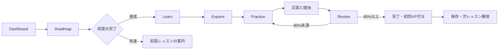

# アーキテクチャ

## 技術構成

| 領域   | 採用技術                                          | 理由                                                 |
| ------ | ------------------------------------------------- | ---------------------------------------------------- |
| アプリ | Next.js App Router / React / TypeScript           | ルーティング、型安全なUI、本番配信を一つの構成で扱う |
| UI     | Tailwind CSS / shadcn/uiの構成方式                | デザイントークンと再利用可能な小さなUI部品を管理する |
| 教材   | ローカルのTypeScript構造化データ                  | コンテンツと画面を分離し、参照と型を検査する         |
| 進捗   | `localStorage` と保存処理のインターフェース       | 外部サービスなしで動作し、将来の移行箇所を限定する   |
| テスト | Vitest / 必要なReact Testing Library / Playwright | ロジックと実際の学習フローを検証する                 |
| 配信   | Next.js対応環境、将来Vercel                       | Phase 1では外部DB・認証・有料APIを必要としない       |

Thaiと日本語のフォントは `@fontsource-variable/noto-sans-thai` と `@fontsource-variable/noto-sans-jp` をnpmから導入し、アプリの静的ファイルとして自己配信する。描画時の外部フォントAPIへの依存はない。ライセンスは `public/licenses/` に同梱する。

## 責務の分離

```text
src/app/             画面ルート、レイアウト、メタデータ
src/components/      共通UI、ナビゲーション、学習画面
src/components/ui/   Button、Card等の再利用可能なUI部品
src/data/            教材、カリキュラム、出典
src/lib/             教材型、進捗・採点などの純粋ロジック、保存アダプター
src/**/*.test.ts     教材整合性と進捗ロジックのユニットテスト
e2e/*.spec.ts        Playwrightの学習フローテスト
public/licenses/    フォントのライセンス
docs/                日本語の設計・カリキュラム・開発計画
```

教材の本文や正答は `src/data/curriculum.ts` に置き、画面コンポーネントへ埋め込まない。クイズ判定・前提判定・XP計算・進捗の検証はUIから独立させる。`src/lib/content-types.ts` が教材の型、`src/lib/progress.ts` が採点・保存の境界、`src/components/learning-provider.tsx` がブラウザの状態管理を担当する。

## 実装済みのデータモデル

| エンティティ     | 主な情報                                                                         |
| ---------------- | -------------------------------------------------------------------------------- |
| Part             | ID、名前、説明、表示順、公開状態                                                 |
| Chapter          | ID、Part ID、名前、説明、Lessonの参照                                            |
| Lesson           | ID、Chapter ID、目標、前提Lesson ID、所要時間、XP、LearningBlock、Exercise、要点 |
| LearningBlock    | ID、見出し、解説の段落、任意の例と補足。解説の種別を分ける型はまだ持たない       |
| ExploreItem      | ID、Thai表記、IPA、日本語訳、構成・発音の注記                                    |
| Character        | 文字、名前、子音クラス、初頭音、任意の末子音、例語、出典、確認状況               |
| ExampleSentence  | Thai表記、日本語訳、IPA、任意の注記                                              |
| Exercise         | ID、種別、問題文、選択肢、正答、解説、学習事項、難易度                           |
| ExerciseOption   | 選択肢ID、表示内容、任意の補足                                                   |
| ContentSource    | ID、題名、発行者、URL、確認日、参照可否、確認対象                                |
| ExerciseAttempt  | Exercise ID、Lesson ID、選択した答え、正誤、回答時刻。受講回IDはまだ持たない     |
| LessonProgress   | 完了日時、最高正答率、受講回数、付与済みXP、最終学習日時                         |
| LearningProgress | スキーマ版、Lesson別結果、回答履歴、学習したローカル日付                         |
| AudioAsset       | 素材参照先、音声種別、ライセンス、確認状況の型のみ。素材・再生機能は未実装       |

Phase 1は6レッスン・合計30問。動作するExerciseは `multiple-choice` と `character-recognition` の判別可能な型で、ほかの演習形式は未実装。追加時も未対応の形式を既存UIで誤って処理しない。

`VowelPattern`、`Syllable`、`Vocabulary`、`GrammarPoint`、`ReviewSchedule` は将来の設計候補であり、独立した型・保存領域・画面としては未実装。現在の母音・音節・例語の解説は `LearningBlock` と `ExploreItem` 等に保持する。SRS、語彙DB、文法リファレンスが完成済みとは扱わない。

LessonとCharacterは出典IDと `source-checked` / `unreviewed` を持ち、資料側に参照可否と確認対象を記録する。現教材は `unreviewed` の教材案であり、専門家の監修は未完了。`source-checked` は資料との照合を表す型上の選択肢で、専門家による監修済みという意味には使わない。

## 学習フロー



回答を確定した問題は同じ受講回で書き換えない。再挑戦は新しい受講回として始める。教材の `prerequisites` が前提の唯一の定義で、URL順やXPから前提を推測しない。

## 進捗と保存

保存データのスキーマ版は `1`、保存キーは `thai-learning.progress.v1`。読み込み時にスキーマ版と各項目の型・範囲を検証する。壊れたJSON、未知の版、欠損や無効な数値はそのまま信用しない。不正な保存データは読み込み時には元のまま保持し、警告して画面内で空の進捗を使用する。その後に新しい受講結果を保存すると元の保存内容を置き換える。ブラウザの書き込み拒否等は捕捉して、保存できていない状態を伝える。

Lesson別には、完了状態、最高正答率、初回完了日時、受講回数、付与済みXPを保持する。正答率80%以上で完了でき、初回完了時だけXPを付与する。再受講は以前の最高正答率を下げず、XPを重複加算しない。学習日と連続学習日数は、利用ブラウザのローカル日付を基準とする。

解説の閲覧位置や途中の回答は永続保存しない。全問を終えた受講結果の記録時に、回答履歴・受講回数・学習日を保存し、合格後の完了操作で完了状態とXPを反映する。途中で再読み込みすると、その受講回の画面内状態は失われる。

他タブの更新は `storage` イベントで同期し、保存の直前にも現在の保存内容を再読み込みする。これにより古いタブによる通常の上書きやXPの二重付与を防ぐ。localStorageにはトランザクションがないため、厳密に同時の書き込みまで保証する仕組みではない。

Progress画面は各Lessonの最高正答率・受講回数・完了状態、全受講回の初回回答の正答率、XP、学習日数を表示する。苦手概念ごとの集計、受講履歴の詳細画面、実測学習時間、SRSは未実装。

進捗アクセスは `ProgressRepository` 等の型付きインターフェースを通す。現在はブラウザの実装を利用し、将来Supabaseへ移行する際はアダプターと認証・同期の設計を追加する。Phase 1にサーバー保存があるようには表示しない。

初期描画時は保存内容の読み込み前に「未学習」と断定しない。ブラウザAPIに依存する進捗・演習部分はClient Componentへ閉じ込め、必要以上にページ全体へ責務を広げない。

## 将来拡張の境界

声調判定は、将来 `Syllable` の明示的な解析結果を受け取るUI独立モジュールとする。例外の辞書補完と判定不能の結果を表現できる必要がある。Phase 1では一般的なThai文字列から声調を推測する機能を実装しない。

筆順は出典・検証情報を持つ専用データとし、字形から手順を自動生成しない。音声は `AudioAsset` のライセンスと確認状況を満たすものだけを使用する。SRS、Supabase、AI会話、録音の実装は後続Phaseに限定する。

## 品質確認

- ユニットテスト：教材の参照・前提関係、採点、80%境界、前提の解放、XPの重複防止、進捗の復元・不正データ。
- E2E：解説から完了まで、誤答の理由、再受講、ロードマップの解放、リロードによる保存確認。
- 表示確認：PCとスマートフォン、横はみ出し、Thaiの上下記号、フォーカス、色に依存しない正誤表示。
- `typecheck`、`lint`、`test`、本番 `build` を実行し、実行できていない検査は理由と共に報告する。
